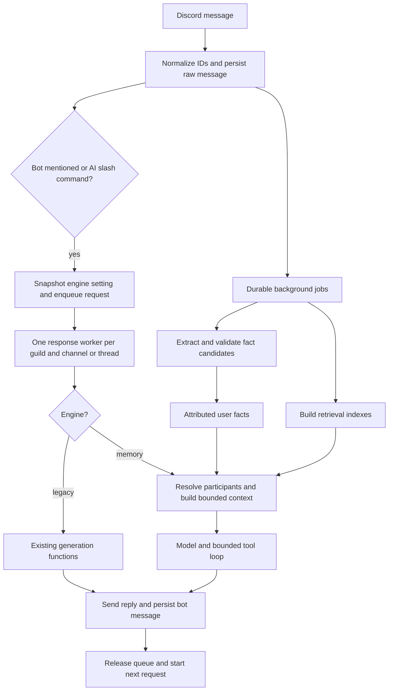

# Discord memory engine design

Status: implemented (first version), 2026-11-13. Legacy remains the default; static user prompt files untouched.

## Implementation notes

Code lives in `src/utils/LLM/v2/` and the `/aiconfig` (named so it does not clash with the `ai` shortcut of `/ask_ai`), `/memory`, `/nickname` commands in `src/Commands/`. Offline tests: `npx ts-node --transpile-only scripts/test-memory-v2.ts`. This needs the same Node major version that `better-sqlite3` was built for (Node 20 in Docker).

| File | Role |
| --- | --- |
| `db.ts` | `memory-v2.db` (next to `VECTOR_DB_PATH`, override with `MEMORY_V2_DB_PATH`), numbered additive migrations |
| `settings.ts` | per-guild engine, web mode, and learning; per-user learning opt-out; model IDs |
| `text.ts`, `nicknames.ts` | normalization, Damerau-Levenshtein, the 0/1/10% typo rule, common-word guard, nickname storage |
| `messages.ts` | immediate message storage with author, reply, mention, and nickname reference IDs |
| `responseQueue.ts` | FIFO per guild and channel or thread, 3 concurrent, per-user and per-channel limits, 45 s timeout |
| `context.ts` | reply chain, recent window, roster, target resolution, ID-tagged transcript, bot replies as assistant turns |
| `facts.ts` | facts are dated by when the message was **sent** (first/last said); the most recently said value wins even if processed out of order (backfill); expiry counts from the send date; replaced and expired facts stay as history. extraction per channel 2 s after it goes quiet (at most 8 s after the first new message; noise like "lol" is skipped without a model call; 5-minute sweep as a safety net), validation, supersession, edit/delete retraction, relevance-gated retrieval with repetition penalty |
| `vision.ts` | captions every posted image (attachments and link previews such as Tenor GIFs) with a cheap vision model and stores the caption with the message; sends the images on the ping and the replied-to message to the reply model directly. Facts come from an image only when the poster's own text claims it ("my new setup") |
| `backfill.ts` | owner-only `/backfill since:<YYYY-MM-DD or 90d> [channel] [images]`: scans Discord history into `memory-v2.db`, DMs the owner counts and a cost estimate with Confirm/Cancel buttons, then extracts facts with progress updates and a Stop button in the DM. Stops by itself above 3x the estimate and resumes confirmed jobs after a restart. Owner ID: `BACKFILL_OWNER_ID` (default `222398053703876628`) |
| `tools.ts` | `search_user_memory` (facts with dates, profile, optional history/date range), `search_messages` (stored chat by date range, author, keywords, channel; only channels the requester can see), `get_conversation_context`, `web_search` (OpenRouter Responses API with `openrouter:web_search`) |
| facts (profile-only) | facts must be in one of 12 profile categories (identity, work_or_school, location, game, skill_or_rank, hobby, taste, habit, personality, possession, relationship, reputation); plans, intentions and time-bound statements are rejected in code. Every fact keeps its source message IDs: `get_fact_source` tool and `/memory source fact:<id>` show the quote and a jump link. `/backfill reset:true` wipes a server's facts and profiles (after DM confirmation) and re-learns the range |
| `profiles.ts` | per-user profile (who, interests, personality, how they talk, running jokes, recent changes) written by the extractor model from current facts and a sample of the user's messages; refreshed in the background when facts change (at most every 30 min per user); shown to the reply model for the people involved and via `/memory profile` |
| `persona.ts` | the bot's personality (4chan-style sarcasm with hard limits) and the system prompt; edit `PERSONA` to change the tone |
| `time.ts` | dates in `BOT_TIMEZONE`, "3 months ago" labels, date parsing for tools |
| `engine.ts`, `router.ts` | reply generation and Discord event wiring |

Environment variables (all optional):

- `V2_CHAT_MODEL`: default `openai/gpt-6-luna`.
- `V2_EXTRACT_MODEL`: default `openai/gpt-6-luna`.
- `V2_SEARCH_MODEL`: default `openai/gpt-6-luna`.
- `V2_SEARCH_ENGINE`: default `exa`.
- `V2_VISION_MODEL`: default `openai/gpt-6-luna`, used for image captions.
- `BOT_TIMEZONE`: default `Europe/Berlin`.
- `MEMORY_V2_DB_PATH`.

Deviations from the design below, and work not done yet:

- **Settings storage.** Engine and web settings live in `memory-v2.db`, not in `GuildSettings`. The settings panel renders one button per setting and only fits booleans.
- **No restart recovery.** Queued requests exist only in memory, so a restart drops pending pings. The `responses` table still prevents duplicate replies to the same trigger.
- **Lexical fact retrieval only.** There are no embeddings, episodes, or conversation summaries yet.
- **Partial message log.** Messages are stored only while a guild uses the memory engine. On first use, the context builder fetches the last 40 messages of the channel from Discord. Older history comes in through `/backfill`, which reads from Discord. The old `vector.db` is not imported.
- **Fuzzy-match guard.** The check that a typo match isn't a real word uses the built-in common-word list (English and German), not a full dictionary. Add your server's frequent words to `COMMON_WORDS` if you see false positives.
- **`/ask` is unchanged.** It still uses the legacy path. Only mentions are routed through the engine toggle.
- **Untested against the live services.** The `web_search` response parsing follows OpenRouter's documented `url_citation` annotations and has not been run against the live API.

## Decision

Keep the existing engine as `legacy`, enabled by default. Add a separate `memory` engine behind a persisted, per-guild slash-command setting. Use SQLite for both immediate conversation storage and structured user facts. Keep embeddings as an optional retrieval index, outside the response-critical path.

The bot should learn by updating external memory, not by changing model weights. Its personality belongs in a short system prompt; personal facts belong in a queryable, attributed store.

## Conversation-aware fact extraction

The extractor reads each message inside its conversation (`extractionContext.ts`):

| Piece | Rule |
| --- | --- |
| Batches | Up to 25 messages, never across a conversation gap of more than 20 minutes in a channel |
| `[CONTEXT]` | Earlier messages of the same conversation, going back at most 45 minutes or 40 messages, stopping at the first 20-minute gap |
| `[REPLIED]` | Messages that someone in the batch replied to and that lie outside that window, up to 2 levels, with author, at any age |
| `[AFTER]` | Up to 6 messages from the 5 minutes after the batch: reactions, so jokes and contradictions are recognized |
| Lines | `[TAG] m4 14:02 Name [user id] (reply to m2 by Name [user id]): text`. Time of day only, no dates |
| Short replies | "same", "me too", or "yes" to a question are analysed when they are replies; laughter never is |
| Gate | Each fact carries `confidence`; only `high` is kept. Plans, time-bound statements and facts outside the 12 profile categories are rejected in code |
| Context evidence | `context_ref` names the message that gives a short reply its meaning. It is stored as a second source (`evidence_type = 'context'`) and shown by `get_fact_source` and `/memory source`. It never counts as support on its own: deleting the real source still withdraws the fact |

Profiles are 150–250 words (Who, Personality, Talks like, Into, Reputation), written from up to 120 facts and the user's last 150 messages. Up to 1,400 characters of a profile go into the reply prompt.

## The three complaints and their fixes

| Complaint | Root cause in code | Fix |
| --- | --- | --- |
| Too fixated on the hardcoded facts | `getUserPrompt()` injects a random 10% of `USER_INFORMATION` plus the user prompt into **every** system prompt, so the model treats them as the topic | v2 never puts facts in the system prompt. Facts are learned from chat, stored with evidence, and only reach the model via relevance-gated retrieval (0–5 per reply, at most one callback per roast) or when the model calls `search_user_memory`. A recently-used-fact penalty stops the same joke from repeating |
| Loses track of who said what | History is `[displayName]: text` with no IDs, `replyTo` is just a name, retrieval ignores `userId`, all user mentions are stripped from the instruction | Every message carries `authorId`, `messageId`, `replyToMessageId`, `mentionedUserIds`. Prompt is built from the reply chain + recent window as structured, ID-tagged turns; the bot's own replies are real `assistant` turns. Requester and target are separate resolved IDs |
| Rapid pings produce garbage | Each ping is an independent concurrent generation; messages only hit the DB after a 30 s delay; bot replies are never stored | Raw messages are persisted instantly. One FIFO response queue per channel/thread: ping 2 starts building its context only after reply 1 is sent and saved, so it sees reply 1 |

## Problems verified in this repository

| Current behavior | Consequence | Replacement |
| --- | --- | --- |
| `vectorDB/queue.ts` waits 30 seconds, then polls every 5 seconds | Rapid follow-ups cannot see recent messages | Persist raw messages immediately |
| `vectorDB/ingest.ts` embeds before inserting the message | Embedding outages also remove live context | Transactional message insert and background jobs |
| `index.ts` returns for bot authors before ingestion | Live bot answers disappear from subsequent context | Store this bot's own sent answers explicitly |
| `retrieveRelevant()` accepts `userId` but does not use it in SQL | Other users' messages are returned as personal context | Explicit subject, guild, and visibility filters |
| `replyAI.ts` omits `targetUserId` when formatting retrieved messages | Retrieved messages from others can appear under “Messages from this user” | Preserve author and subject IDs throughout |
| `ChannelMessage` retains only names, content, and a reply-to name | Renames, duplicate names, and reply chains become ambiguous | Full message records and reply edges |
| `extractInstruction()` removes every user mention | “Roast @someone” loses the target identity | Remove only the bot mention; resolve other mentions by ID |
| Each mention starts an independent generation | Responses race and use incomplete conversation state | Ordered generation and sending per channel/thread |
| Static user prompts and random background facts enter the system prompt | Repeated, unrelated personal references | Relevance-gated facts supplied as evidence |
| Storage has no guild column and ingestion uses one hardcoded guild | Expanding to more servers risks shared personal context | Scope every memory operation by guild |
| Old-schema detection drops message tables | A future migration can discard history | Additive, versioned migrations with backups |

## Message flow



Raw logging must finish before the first asynchronous embedding/model operation. Other bots do not trigger generation or fact learning. This bot's own replies are context, never evidence for personal facts. Reuse the same response router for mentions and `/ask` AI entry points so they share ordering, tools, and rate limits.

## Identity and conversation context

Keep Discord snowflakes as strings; never convert them to JavaScript numbers. Store `guildId`, `channelId` (the actual thread ID when inside a thread), `messageId`, `authorId`, `authorNameAtSend`, `createdAt`, `replyToMessageId`, `mentionedUserIds`, `content`, `editedAt`, `deletedAt`, and `isOwnBot`.

Names are display labels. User identity is `(guildId, userId)`. A quoted person's statement, its author, the requesting user, and the roast target are separate fields.

Resolve an explicitly mentioned target first; otherwise use the replied-to human author for a targeted request, then a confident nickname reference in the instruction (see [Nicknames](#nicknames)), then the requester. A reply to the bot continues the conversation and preserves the bot's prior answer and its parent message. Detect the bot using `client.user.id`, not the current hardcoded ID. When several explicit users could be the target, retain all IDs and resolve from the instruction; ask a brief clarification if still ambiguous.

Build each request from:

1. The current instruction with requester and resolved targets.
2. Its reply chain, including bot replies; fetch missing ancestors from Discord with permission checks and a depth cap of 10.
3. Up to 40 recent channel/thread messages, oldest first, within a starting budget of roughly 4,000 tokens.
4. A small conversation summary for older context, with referenced message IDs and participants.
5. Zero to five relevant, eligible facts and optionally a few attributed historical episodes.

Deduplicate messages across these sources. Keep the instruction and reply chain when trimming. Summaries are lossy context, never the source of truth for facts. For unrelated interleaved conversations, prioritize reply edges and participants over simple proximity.

Represent human messages as structured user content with trusted metadata supplied by the application. Only this bot's actual outputs receive the assistant role. Retrieved history, memories, and web text are data, not system instructions. Supply the current date explicitly.

## Nicknames

People in the server refer to each other by names that are not their Discord display names ("Dani", "Serg", an in-joke). The bot must map those names to user IDs so attribution, roast targets, and fact subjects stay correct.

### Commands

```text
/nickname add user:<user> name:<string>
/nickname remove user:<user> name:<string>
/nickname list [user]
```

`user` is a Discord USER option. It stores and returns the snowflake, and users can paste a raw ID into the picker. If you need to accept IDs of people who left the server, add an optional STRING `user_id` fallback and validate it as a 17–20 digit snowflake. `name` is 2–32 characters after trimming.

- Anyone can add a nickname, which suits a friend-group bot. Store `added_by` on every row.
- The nicknamed user or anyone with Manage Server can remove it. Cap aliases at 10 per user.
- Replies are ephemeral except `list`.
- Nicknames are per guild and work in both engines' storage. Only the `memory` engine reads them for resolution, and legacy stays unchanged.

### Storage

Table `nicknames` in `memory-v2.db` has these columns:

- `guild_id`, `user_id`
- `nickname`, the name as typed
- `normalized`
- `source`: `manual`, `display_name`, `username`, or `global_name`
- `added_by`, `created_at`

It has a unique constraint on `(guild_id, normalized, user_id)`.

The resolver also treats each member's current server display name, global name, and username as automatic aliases. It refreshes them on `guildMemberUpdate` and when it sees a message. Manual nicknames win over automatic aliases.

If the same normalized nickname already belongs to a different user, `add` refuses and names the current owner. That prevents ambiguity at the source. A moderator can remove the old entry first.

Keep an in-memory alias index per guild, rebuilt on any change. A server has at most a few hundred aliases, so brute-force matching costs microseconds.

### Normalization

Apply the same normalization to aliases and to message text:

1. Unicode NFKD, then strip combining marks, so `Jöshi` becomes `joshi`. Also store a German transliteration variant (`ö` → `oe`) as a second normalized form.
2. Lowercase.
3. Drop everything except letters, digits, and spaces, and collapse whitespace.

Words in a message are matched as 1- to 3-word n-grams, because nicknames can contain spaces. Each n-gram is also tried with a trailing possessive (`s`, `'s`, `’s`) removed, so "Danis" and "Dani's" match "Dani".

Ignore text inside code blocks, URLs, and existing `<@id>` mentions. Mentions already carry the ID.

### The 10% leniency rule

Use the Damerau-Levenshtein distance, so a swapped pair of letters counts as one edit. A candidate matches an alias when:

```text
allowed(alias) = length(alias) >= 5 ? max(1, floor(0.10 * length(alias))) : 0
distance(candidate, alias) <= allowed(alias)
```

Length is measured after normalization. Above 10 characters this is exactly "at most 10% of the name may be wrong". For 5–9 characters it is rounded up to one typo, so typical short nicknames survive a slip.

| Alias length | Typos tolerated |
| --- | --- |
| 1–4 chars (`dani`, `karl`, `til`) | 0, exact match after normalization only |
| 5–19 chars (`sergej`, `lukas`, `chainsawdaniel`) | 1 |
| 20–29 chars | 2 |

Aliases of 4 characters or fewer stay exact. The current legacy `getUserByName()` allows a fixed distance below 3, so `til` already matches common words such as `the` or `tim`.

Extra guard for the 5–9 band, where one typo is 11–20% of the name: a fuzzy match (distance 1) is rejected when the candidate is itself a word on the stopword/dictionary list. "lucas" still resolves to `lukas`, but "mason" does not resolve to `jason`. Exact matches skip this check, though the common-word guard below still applies to them.

Pick a winner deterministically:

1. Lowest distance wins, and exact matches beat fuzzy ones.
2. Longer matched spans beat shorter spans that overlap them, so "big dani" beats "dani".
3. Manual aliases beat automatic ones.
4. If two different users still tie, the reference is ambiguous. Record both IDs and resolve neither.

### Common-word guard

An alias that is also a normal word ("max", "chef", "king") only resolves when at least one of these is true:

- It is capitalized in the original text.
- It is the direct object of the instruction, as in "roast max".
- That user took part in the last 20 messages.

Otherwise it is recorded as a low-confidence reference. Keep a small stopword list for the server's languages (English and German) and check each alias against it at `add` time. Warn when a nickname collides with a common word, but still allow it.

### How the bot uses the matches

Name resolution runs during message normalization. Each stored message gets a list of resolved references:

```json
{
  "start": 6,
  "end": 10,
  "text": "Dani",
  "userId": "222398053703876628",
  "alias": "dani",
  "distance": 0,
  "confidence": "high"
}
```

- **Prompt:** confident references are annotated inline in the transcript the model sees, as `Dani [user 222398053703876628]`. Ambiguous ones become `Max [ambiguous: user A or user B]`. The participant roster at the top of the prompt lists each user ID with its display name and nicknames, so the model knows which name is which user. Low-confidence references are not annotated.
- **Target resolution:** order is explicit mention, then reply target, then a confident nickname reference in the instruction, then the requester. The instruction "roast dani" therefore targets Daniel's ID even without a ping.
- **Fact extraction:** the extractor receives the resolved IDs. "Dani bought a 4090", said by Bob, becomes a `third_party_claim` about Daniel's ID, reported by Bob. Nicknames themselves never become facts, and only the command writes them.
- **Tools:** `search_user_memory` accepts names and resolves them through the same index, so the model can look up "dani" without knowing the ID.
- **Re-resolution:** adding or removing a nickname re-resolves only future messages and the active context window. Do not rewrite stored evidence. Facts already attributed to the wrong person are fixed through `/memory forget`.

## Concurrency and rapid pings

Use one FIFO response queue per `(guildId, channelId)`, including independent queues for Discord threads. Different channels can run concurrently under a small global concurrency cap. Queue the whole resolve/build/generate/send/persist operation, not just the model call.

Persist request IDs with a unique constraint on the triggering Discord message or interaction ID. Use states `pending`, `running`, `sending`, `sent`, `failed`, and `cancelled`, plus the selected engine, settings version, and sent reply ID. A second request builds its prompt when it reaches the queue head, after the previous answer has been saved.

The default is one reply per accepted ping, in arrival order. Do not silently merge different users' requests or retarget a running answer. A later “actually...” message belongs to a later request unless explicitly implementing cancellation. Freeze a context snapshot at generation start so tool-loop continuation sees consistent history. Include earlier queued bot answers, but do not treat later pending user requests as instructions for the current one.

Starting limits: 10 pending requests per channel, 3 accepted triggers per user per 10 seconds, 30 seconds total execution time per request, and 3 total active generations. Reply briefly when the queue is full. Always release locks in `finally`; refresh typing while waiting/running. Cancel a pending request if its trigger is deleted; edits increment its revision and invalidate stale work.

On restart, recover unsent work with a bounded age limit. Discord sends and SQLite commits are not atomic: a crash after sending can leave an uncertain outcome. Reconcile using the stored trigger/reply reference where possible; do not blindly resend uncertain `sending` jobs. A single process can use an in-memory keyed worker backed by persisted jobs. Multiple bot processes require durable leases or a shared queue before deployment.

## Three different forms of memory

| Kind | Example | Behavior |
| --- | --- | --- |
| Conversation state | Who said “that GPU is overpriced,” and what reply they meant | Exact IDs, chronology, reply edges; available immediately |
| User fact | User 123 says they own an RTX 4070 | Structured, evidence-backed, revisable |
| Episode | User 123 lost a ranked match after boasting | Dated event with source messages; useful for an occasional callback |

Do not equate a semantically similar message with a true fact about its author. Distinguish the fact's subject from the person reporting it.

Suggested records in a separate `data/memory-v2.db`:

- `messages`: the fields above; unique `(guild_id, message_id)`; indexed guild/channel/time and guild/author/time.
- `facts`: `id`, `guild_id`, `subject_user_id`, `predicate`, `value_json`, `normalized_key`, `kind`, `status`, `source_kind`, `first_seen_at`, `last_confirmed_at`, `valid_from`, `valid_until`, `expires_at`, `supersedes_fact_id`, `extractor_version`.
- `fact_evidence`: `fact_id`, `message_id`, `message_revision`, `reporter_user_id`, `evidence_quote`, `evidence_type`; multiple independent sources can support a fact.
- `episodes`: `id`, `guild_id`, `channel_id`, `participant_ids`, `summary`, `source_message_ids`, `occurred_at`, `expires_at`.
- `conversation_summaries`: guild/channel, bounded source range, participant IDs, summary, revision.
- `jobs`: extraction/indexing/summary/response work, idempotency key, input revision, attempts, next retry, lease, state.
- `responses`: trigger, engine/model, tool usage, bot reply ID, fact IDs referenced, timing, token and estimated cost totals.
- `memory_preferences`: per-guild/user learning and deletion settings.

Use foreign keys, WAL, transactions for related writes, and a numbered migration table. Raw storage must not require loading sqlite-vec. Start with SQL and optional FTS5 for facts; add vectors where semantic recall demonstrably helps. Validate index dimensions and embedding-model versions independently.

## Learning facts

An asynchronous worker batches small, contextual message groups and requests schema-validated fact candidates. It receives author IDs, mention IDs, reply edges, and source text. Require an exact evidence quote, subject ID, predicate/value, source message ID, and classification: `self_report`, `third_party_claim`, `joke`, `temporary_state`, or `correction`. A confidence number is an aid, not a calibrated probability or permission to invent facts.

Application validation checks the source exists at the recorded revision, quote matches, guild and subject are valid, and the evidence actually supports the claim. Reject unsupported IDs, bot-generated claims, instructions to rewrite other people's memories, and schema violations. Unresolved subjects remain candidates and are not used as established facts.

Examples:

- Alice: “I bought a 4070.” → Alice self-reported owning a 4070, sourced to this message.
- Bob: “Alice owns a 4090.” → Bob's claim about Alice; it does not overwrite her self-report.
- Alice: “Bob said 'I bought a 4090'.” → Not a self-report about Alice.
- Alice: “I'm literally a toaster.” → Joke, not a durable identity fact.
- Alice: “I sold the 4070 and bought a 5070.” → New current ownership with dated supersession of the old fact.
- Alice: “I also have a laptop.” → Add another possession; do not replace the GPU fact. Predicates must distinguish single-value and multi-value relationships.

Promote clear self-reports directly when validated. Keep hearsay as attributed claims, with lower retrieval priority, never silently upgraded by repetition. Keep corrections and provenance rather than destructive overwrites. Expire temporary states quickly; durable preferences remain until corrected or forgotten. Episodes expire sooner than durable facts. Run scheduled expiry/revalidation rather than treating old information as current forever.

Handle message updates and deletes: invalidate old extraction jobs by revision, remove affected evidence/index entries, recompute whether a fact still has valid support, and regenerate affected summaries. Forgetting a user removes derived memories and blocks re-extraction from retained raw messages until their preference changes; purge associated queued jobs and caches as well.

## Retrieving facts without repetitive roasts

Apply hard filters first: guild, allowed source-channel visibility, eligible status, non-expired evidence, and requested subjects. A fact may only surface where its evidence is allowed to be surfaced; default learning to configured server channels and never transfer private-channel knowledge into public replies. Cross-server memories are disabled.

Rank eligible candidates using current topic relevance, evidence strength, recency appropriate to the predicate, and novelty. Use hybrid lexical/semantic retrieval when needed. Subject filtering must happen before top-k selection, or use an exact filtered search; global nearest neighbors followed by a tiny post-filter can miss the target user's facts entirely.

For a general question, send no personal facts unless they improve the answer. For a roast, prefer the current message and situation; include one relevant callback at most. Track recently referenced fact IDs per channel and target, with a starting penalty covering the last 10 bot replies or 24 hours. Facts may still be used when directly requested, even if recently referenced. Measure repetition and tune these starting values from actual conversations.

No automatic import of static user prompt files into v2. They may contain jokes, assertions, and behavior instructions rather than reliable facts. Keep them intact for legacy. An optional explicit seed import labels each entry `curated_seed`, preserves its source, and sends it through the same relevance and novelty rules.

## Tool calls

Expose a small set of tools to the new response service:

| Tool | Contract |
| --- | --- |
| `search_user_memory(userIds, query)` | Read eligible facts/episodes for current guild and allowed subjects |
| `get_conversation_context(messageId, limit)` | Read bounded, visible reply context |
| `web_search(query)` | Retrieve current public information with titles, URLs, dates, and excerpts |

The application injects guild/user/channel authorization; the model cannot choose an arbitrary guild or bypass channel access. Automatic memory writes stay in the validated background pipeline. Explicit remember/forget commands use the same validation and ownership checks.

Search when freshness matters, the user requests it, or an obscure factual claim needs verification. Ordinary banter needs no web lookup. Search public topics, not Discord IDs or private server transcripts. A public search result cannot establish a fact about a Discord member merely because names match.

Start with at most 3 model/tool rounds, 2 web searches per answer, bounded result text, an 8-second timeout per lookup within the overall request deadline, caching for repeated public queries, and per-guild spend ceilings. Treat tool errors as typed results; allow a short answer with a clear uncertainty statement when lookup fails. Never claim a search succeeded when it did not. Render clickable source links for web-derived factual claims and keep the full answer within Discord's message limit.

Retain OpenRouter behind a provider adapter. Its current `openrouter:web_search` server tool is model-callable; server tools are beta, so isolate provider-specific request/response handling. Verify the installed AI SDK/provider supports the server-tool schema and citation results; use a small HTTP adapter or a custom search function if it does not. Do not assume the current alpha provider dependency supports newly documented features.

An alternative is direct OpenAI Responses with `web_search`. Keep message context application-owned in either case. Tool compatibility is an explicit model capability, not implied by an OpenAI-compatible endpoint.

## Slash commands and compatibility

```text
/aiconfig engine mode:legacy
/aiconfig engine mode:memory
/aiconfig status
/aiconfig web mode:auto|off
/memory show [user]
/memory forget fact:<id>
/memory learning enabled:true|false
/nickname add user:<user> name:<string>
/nickname remove user:<user> name:<string>
/nickname list [user]
```

`/aiconfig engine` and `/aiconfig web` require Manage Guild (also check permission at execution). Persist settings per guild through the existing settings mechanism, with absent engine setting resolving to `legacy`. `/ai status` reports engine, model, web availability, learning state, and pending count without exposing facts. Memory views and personal deletion responses are ephemeral; default `show` to self and restrict other-user inspection to authorized moderators. Self-service forgetting/learning changes affect only the invoking user's memories; moderator operations require explicit targets and permissions.

The new engine must be toggleable independently of model choice. Snapshot the engine at enqueue time: an already accepted request finishes with its original engine, and requests accepted after a successful toggle use the new engine. Do not run both generators or post duplicate replies. Switching to legacy retains v2 data and pauses its fact extraction by default; background work rechecks learning mode before committing. Do not silently fall back from v2 to legacy on errors, since that reintroduces the very static context the user is avoiding.

Keep legacy prompt/fact files, retrieval, and generation intact behind an adapter. Shared request ordering and output logging can wrap both paths without replacing their prompt behavior. The separate v2 database allows rollback without depending on the legacy database's destructive migration path. Existing database rows lack guild IDs; import only after channel-to-guild resolution, otherwise quarantine them. Do not run a fresh 90-day backfill automatically. Any later backfill is bounded, resumable per channel, and opt-out-aware.

The current command interface only types flat options. Implementing the subcommand syntax above requires extending its option representation and registration path; use the Discord-supported option types rather than hiding subcommands behind casts. Avoid relying on the settings panel's single row of buttons as settings grow.

## Implementation sequence

1. Add engine interfaces, a persistent guild selector defaulting to legacy, command registration, and one response router for AI entry points.
2. Add independent v2 storage, immediate normalization/logging, own-answer persistence, ordered response processing, full identity/reply context, and the `/nickname` commands with fuzzy name resolution. Validate attribution before adding learned facts.
3. Add structured facts, evidence validation, revision-aware jobs, correction/expiry/deletion behavior, and memory inspection commands.
4. Add relevance and repetition controls; evaluate with and without fact context against the same transcripts.
5. Add provider adapters and bounded tools with source links; verify actual endpoint capabilities and SDK support.
6. Replay a representative test corpus, then opt one guild into v2. Leave legacy selectable and retain both databases.

Suggested modules: `src/utils/LLM/engines/{types,legacy,memory}.ts`, `conversation/{normalize,context,responseQueue,nicknames}.ts`, `memory/{db,migrations,extract,validate,retrieve,jobs}.ts`, `tools/{memory,conversation,webSearch}.ts`, and `src/AdminCommands/AI.ts`. Extract shared personality wording without copying static user context into v2.

## Acceptance checks

- Two users with identical display names never share facts. Renaming a user preserves identity.
- Nicknames: "roast dani" targets Daniel's ID without a ping, and "Danis", "Dani's" and "DANI" all resolve. A 5–19 character alias ("sergej", "chainsawdaniel") tolerates one typo, and a 4-character alias tolerates none. A dictionary word one typo away from a 5–9 character alias does not resolve. A nickname shared by two users is refused at `add` time. A common-word alias in ordinary prose does not resolve.
- In interleaved conversations and reply-to-bot follow-ups, statements remain attached to the correct author and reply target.
- Three rapid pings get ordered answers; answer two sees answer one. A failed first request does not deadlock later ones.
- Embedding/search outages do not prevent recent message storage or ordinary responses.
- Duplicate Discord events do not create duplicate facts or duplicate replies; uncertain sends reconcile after restart.
- A third-party joke does not become a self-reported fact. Corrections supersede the right predicate without deleting unrelated facts.
- Editing/deleting evidence updates memory; forgetting cannot be undone by an old queued extraction or backfill.
- No facts cross guild boundaries or leak from restricted channels into public answers.
- Unrelated hardware questions do not trigger unrelated personal lore; repeated roasts use varied current context.
- Switching engines survives restart, affects only the intended guild, and preserves the legacy path and data.
- Current-information questions use search when available and include real source links; tool failure never fabricates results.

Use transcript fixtures with expected author/target IDs and fact records for deterministic checks, plus human ratings of humor, usefulness, repetition, and tone. Start with 30-50 representative cases. Track attribution errors, stale/incorrect facts, memory-reference repetition, p50/p95 response latency, queue wait, and total cost including extraction and tools. Model quality alone does not validate the architecture.

## Model recommendations

Slugs, prices (USD per 1M tokens, input / output) and capabilities below come from OpenRouter's live `/api/v1/models` catalog on 2026-11-13. Every candidate lists `tools` and `structured_outputs`, so all of them work with the `openrouter:web_search` server tool and custom function tools. These are candidates for a bake-off on real transcripts, not measured rankings for this bot.

| Role | Primary pick | Alternatives | Why |
| --- | --- | --- | --- |
| Default reply model (every ping) | `anthropic/claude-haiku-5.5` — 0.10 / 0.50 | `openai/gpt-6-luna` — 0.10 / 0.50; `deepseek/deepseek-v4.1-flash` — 0.05 / 0.20 | Cheap enough to run on every ping with tools; ~5x cheaper on input than the current `google/gemini-3-flash-preview` (0.50 / 3.00) |
| "Spicy" / quality tier (toggle or per-guild) | `anthropic/claude-sonnet-5.5` — 2.00 / 10.00 | `openai/gpt-6.1-terra` — 1.00 / 5.00; `google/gemini-3.8-flash` — 0.83 / 4.13 | Better at keeping multi-party attribution straight and at timing a joke well. Terra is the cheapest flagship-class option |
| Background fact extraction | `openai/gpt-6-luna` — 0.10 / 0.50 | `anthropic/claude-haiku-5.5` | High volume, strict JSON schema. Use the `:batch` variant (0.05 / 0.25) since extraction is not latency-sensitive |
| Embeddings (optional) | keep `openai/text-embedding-3-small` | — | Only for fuzzy fact recall; not on the critical path |

Cost sketch for one reply (4,000 input + 150 output tokens, before tools): Haiku 5.5 or Luna ≈ $0.0005, Gemini 3 Flash preview (current) ≈ $0.0025, Terra ≈ $0.0048, Sonnet 5.5 ≈ $0.0095. Each web search adds the search engine's per-request charge (reported in `usage.server_tool_use.web_search_requests`). Batch passive-message extraction every 1–2 minutes per channel, rather than once per message.

Make chat, extractor, and embedding models separately configurable (env + `/aiconfig status`), and record model ID per response so the bake-off can compare roast quality, attribution errors, and cost on the same transcripts. A newer model is not automatically a funnier one.

Sources:

- [OpenRouter model catalog / API](https://openrouter.ai/api/v1/models)
- [OpenRouter web search server tool (beta)](https://openrouter.ai/docs/guides/features/server-tools/web-search)
- [OpenRouter server tools overview](https://openrouter.ai/docs/guides/features/server-tools)
